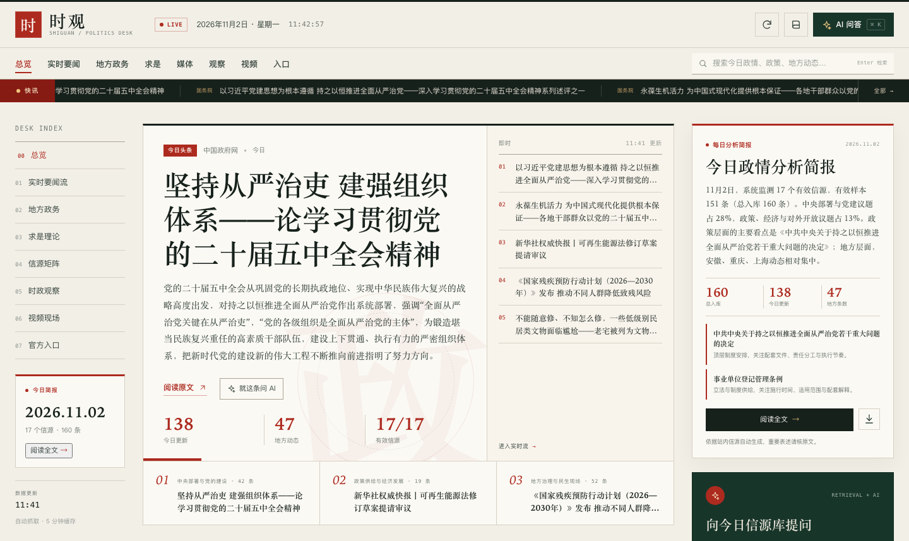

# 时观 · 全国时政实时雷达

一个零依赖的全国时政信息聚合站：把国务院、中央媒体、求是理论、地方政务与视频平台检索入口放在同一张“编辑台”上，并提供每日分析简报与站内 AI 问答。



## 运行

要求 Node.js 22+（使用内置 `fetch`、`WebSocket` 不需要安装依赖）。

```bash
cd shiguan
node server.mjs
# 或 npm start
```

打开 <http://127.0.0.1:4173>。

可选环境变量：

| 变量 | 作用 | 默认 |
| --- | --- | --- |
| `PORT` | 监听端口 | `4173` |
| `DEEPSEEK_API_KEY` | 启用 DeepSeek 生成问答；不设置则使用本地检索增强回答 | 空 |
| `DEEPSEEK_BASE_URL` | DeepSeek 兼容 API 地址 | `https://api.deepseek.com` |
| `DEEPSEEK_MODEL` | 模型名 | `deepseek-chat` |

## 模块

- **总览**：今日头条、三条主线、今日统计、即时快讯。
- **实时要闻流**：按中央/政策/地方/媒体/求是筛选，支持相关度检索、最新/热度排序、渐进展开。
- **地方政务**：7 个实时地方信源（北京、上海、湖北、河南、安徽、重庆、陕西），并附 31 省区市 + 港澳官方入口。
- **求是理论**：求是网理论文章、理论机构入口。
- **信源矩阵**：10 个全国性信源（国务院、政策文件库、新华、人民、央视、求是、光明、中新、经济、观察者）与地方信源的健康状态、延迟、条数。
- **时政观察**：8 个头部时政账号的微博/微信检索入口；微博实时热搜中的时政词，不足时明确标注“站内高频词”，不冒充平台热搜。
- **视频现场**：B站公开检索结果（标注“平台视频·需核验”）+ 小红书/B站主题与政务号检索入口。
- **官方入口**：25 个国务院部委、33 个省级政府、14 家官媒、7 家理论机构。
- **每日简报**：根据当日信源结构生成三条主线、政策信号与含义、高频议题、研判提示；可复制摘要或导出 Markdown。
- **AI 问答**：站内 160 条信源检索增强，回答带编号引文与原文链接；无 API Key 时不会把检索结果说成“模型通识”。

## 数据与更新

- 服务端每 5 分钟刷新一次，首次启动即抓取；手动刷新有 20 秒节流。
- 资讯池保留 160 条，其中政策文件最近 10 条、每个地方实时源最近 2 条优先保留，避免被高频新闻挤掉。
- 前端每 120 秒静默刷新一次。
- 单次抓取失败不会中断整站：失败源会显示为“离线”，其他源继续展示；极端情况下才使用内置静态样例并标记。

主要接口：

```text
GET  /api/dashboard?refresh=1   聚合数据（refresh=1 强制刷新）
POST /api/ask                   {"question":"今天国务院有哪些政策信号？"}
GET  /api/health                健康检查
```

## 平台限制与编辑原则

- 微博用户时间线接口对访客返回 432/登录拦截，小红书搜索页需要登录，因此这两个模块只提供**可核验的检索入口**，不镜像、不伪造帖子。
- B站使用公开搜索接口，只展示标题、作者、播放量、时长与跳转链接；视频内容版权归原作者，站内标注“平台视频·需核验”，不替代官方发布。
- 所有摘要来自信源标题、meta 描述或首段；简报与问答均提示“以原文为准”，不把自动摘要包装成官方解读。
- 外链统一 `target="_blank" rel="noopener noreferrer"`；渲染前做 HTML 转义，仅允许 http(s) 链接。

## 文件

```text
server.mjs          零依赖 Node 服务、抓取/解析/缓存/简报/本地 RAG
public/index.html   页面结构
public/styles.css   报馆编辑风样式与响应式布局
public/app.js       数据渲染、筛选、搜索、简报、AI 抽屉
public/assets/       favicon
```

> 本项目是信息聚合与检索工具，不构成政策解读、投资建议或对任何事件的定性。涉及政策表述、数据与人事信息，请回到原始发布核验。
